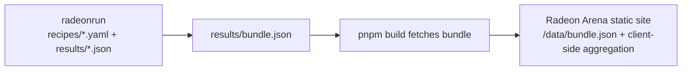

# Radeon Arena

A static **LLM performance leaderboard for AMD Radeon GPUs**.

Radeon Arena is now a pure display site: it does not run benchmarks, accept web-form submissions, host an admin console, or maintain a database. The benchmark source of truth lives in [`radeon-arena/radeonrun`](https://github.com/radeon-arena/radeonrun), where recipes and measured result JSON files are versioned in git.

## Current Architecture



- Data source: bundled static file `/data/bundle.json` (downloaded from `radeonrun/results/bundle.json` during `pnpm build`)
- Website: `https://radeon-arena.com/`
- No runtime API routes, no Postgres, no auth tokens, no admin UI
- Submit flow: users open a pull request in `radeon-arena/radeonrun` with a recipe and measured result file
- Public policy pages: `/terms`, `/privacy`, and `/data-policy`
- Two languages: English at the root (`/docs`), Chinese under `/zh` (`/zh/docs`). Every page and every blog post exists in both. The account pages (`/me`, `/login`, `/device`) are served by the API service and are English only.

## Stack

| Layer | Choice |
|---|---|
| Framework | Next.js 14 App Router, `output: "export"` |
| Styling | Tailwind CSS |
| Data | GitHub raw `radeonrun/results/bundle.json` |
| Hosting | Static web hosting |

## Development

```bash
pnpm install
pnpm dev
# open http://localhost:3000
```

Build the static export:

```bash
pnpm build
# output is written to ./out
```

## Production

Production serves the static export at:

```text
https://radeon-arena.com/
```

Deployment is a static-file publish of the generated `out/` directory.

## Static Export

```bash
pnpm build
# output is written to ./out
```

## Project Layout

```text
src/
  app/
    (en)/                      # English routes, root layout with lang="en"
      page.tsx                 # homepage
      [hw]/[[...rest]]/page.tsx  # /{hw}/{tab}
      blogs/page.tsx, blogs/[slug]/page.tsx
      docs/page.tsx            # API docs
      terms/, privacy/, data-policy/
      leaderboard/page.tsx     # legacy redirect to /strix/leaderboard
    (zh)/zh/                   # the same routes in Chinese, root layout with lang="zh-CN"
    sitemap.ts                 # both languages, with hreflang
  views/                       # page bodies shared by both languages (home, device tabs, blog)
  components/
    SiteLayout, Header, Footer, LangSwitch, LangProvider, Carousel, leaderboard views
  lib/
    i18n.ts                    # Lang, lp() for /zh paths, t() for strings
    blog.tsx                   # hand-written posts (POSTS and POSTS_ZH)
    blogModels.tsx             # generated model and engine posts, both languages
    blogUi.tsx                 # blog typography and the BlogPost type
    githubData.ts              # reads /data/bundle.json in the browser
    benchmarkMapping.ts         # maps raw radeonrun rows -> Benchmark[]
    aggregate.ts                # snapshot/carousel aggregation
    scoring.ts                  # users/orgs leaderboard scoring
    types.ts                    # domain model
```

## Data Flow

1. A recipe is added to `radeonrun/recipes/*.yaml`.
2. The radeonrun `reproduce.yml` workflow runs it on a self-hosted Radeon runner.
3. The workflow commits `results/<device>/<recipe>.json` plus regenerated `results/index.json` and `results/bundle.json`.
4. The radeon-arena build downloads that bundle into `public/data/bundle.json`.
5. The static site reads `/data/bundle.json` and aggregates the leaderboard in the browser.

## Languages

- Client components read the language with `useLang()`; server pages get a `lang` prop. Internal links go through `lp(lang, path)` so Chinese pages stay under `/zh`.
- Canonical and hreflang for `/`, `/docs`, `/blogs`, the device tabs and the policy pages (and their `/zh` twins) come from nginx `Link` headers without a trailing slash; those pages declare none in HTML. Blog posts declare theirs in HTML, with a trailing slash.
- A hand-written post needs both versions in `src/lib/blog.tsx`; the build fails if the English and Chinese slugs differ.

## Blog posts generated from the bundle

The model and engine posts are generated, in English and Chinese, from the radeonrun bundle. Rerun after the bundle changes:

```bash
python3 scripts/gen-blog-posts.py public/data/bundle.json > src/lib/blogModels.tsx
```

Hand-written notes in the script (`NOTES`, `NOTES_ZH`, `ENGINE_NOTES`, `ENGINE_NOTES_ZH`) may only use numbers that are in the bundle; the script checks this and stops otherwise.

## License

MIT
